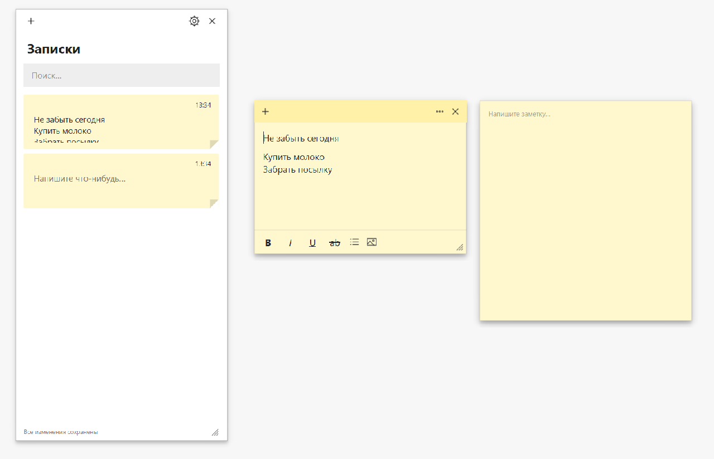

<div align="center">


# JXT Sticky Notes — Windows UI fork

**Заметки в стиле Windows Sticky Notes: общий список, поиск и скрывающийся заголовок.**
Desktop application built with Python and PySide6, based on [jxtsidhu/JXT-Sticky-Notes](https://github.com/jxtsidhu/JXT-Sticky-Notes).

[](LICENSE)




</div>

---

## Features

- **Notes list**: one searchable library of all notes, including closed notes, sorted by last edit
- **Close without deleting**: `×`, `Ctrl+W`, and `Alt+F4` save and close a note; reopen it from the list
- **Windows-style UI**: white library, paper-colored cards, square corners, colored note headers
- **Folding header and formatting bar**: animate into view on hover or while editing; fold away on inactive notes
- **Formatting toolbar**: bold, italic, underline, strikethrough, bullets, and embedded images
- **Russian note and library interface**; the original customization settings remain available in English
- **Auto-start with Windows** and **start minimized to the system tray**
- **Unlimited notes**: frameless, draggable, resizable
- **Always on top**: globally, or pin individual notes
- **Full customization** from a dedicated settings window (live preview):
  - Note colors: 10 curated presets plus any custom color
  - Auto text contrast or your own text color
  - Any installed font, adjustable text size
  - Note opacity (frosted glass look), corner roundness, drop shadow
  - Default size for new notes
- **Per-note overrides**: color, transparency, text size, always-on-top
- **Minimal by design**: controls appear when you hover or edit a note
- **Collapse** a note to its title bar with a double-click
- **Autosave**: your notes and positions are restored exactly as you left them
- **Single instance**: launching it again simply brings your notes forward
- **Private**: everything is stored locally. No accounts, no network, no telemetry

<div align="center">

</div>

## Download

Build this fork using the instructions below, or use a binary explicitly published in this fork's [Releases](https://github.com/Mathias143000/JXT-Sticky-Notes/releases). Upstream release binaries do not include this UI.

> **Note:** the exe is not code-signed, so Windows SmartScreen may show a warning the first time.
> Click **More info → Run anyway**, or build it yourself from source (below).

## Using it

| Action | How |
| --- | --- |
| New note | `+` on a note, `Ctrl+N`, or the tray menu |
| Open notes list | Click the tray icon, note menu → **Список заметок**, or `Ctrl+H` in a note |
| Search / reopen saved notes | Type in **Поиск…** in the list; click a card or select it and press Enter |
| Close and keep a note | `×`, `Ctrl+W`, or `Alt+F4` |
| Permanently delete a note | Note `⋯` menu → **Удалить заметку**, or right-click its card in the list |
| Move a note | Drag its top bar |
| Resize | Drag the bottom-right corner |
| Colors, transparency, text size, duplicate, delete | `⋯` menu on a note |
| Keep a note on top | `⋯` menu → **Поверх других окон** |
| Collapse / expand | Double-click the top bar |
| Show / hide open notes | Tray menu → **Показать заметки / Скрыть заметки** |
| Settings | Tray icon → **Settings…** |
| Bold / italic | `Ctrl+B` / `Ctrl+I` |
| Underline | `Ctrl+U` |
| Insert image | Image button in the note's formatting bar; image data is saved inside the note |
| Strikethrough | `Ctrl+Shift+X` |
| Bullet list | `Ctrl+Shift+L` |

**Start with Windows** is turned on the first time you run the app. To turn it off, open **Settings → General** (or right-click the tray icon). It uses the per-user registry `Run` key, so uninstalling is as simple as switching it off and deleting the exe.

## Run from source

Requires Python 3.10+ on Windows.

```bash
git clone https://github.com/Mathias143000/JXT-Sticky-Notes.git
cd JXT-Sticky-Notes
python -m pip install -r requirements.txt
python main.py
```

## Build the exe yourself

```bat
build.bat
```

This installs the build tools, generates the icon and produces `dist\JXT-Sticky-Notes.exe` using PyInstaller.

## Where is my data?

Notes and settings are stored as plain JSON in `%APPDATA%\JXTStickyNotes\`
(`notes.json` and `settings.json`). **Settings → About → Open data folder** takes you there. Copy the folder to back up or move your notes.

This fork uses the same data folder as the original app. Existing notes load automatically, with their content, color, position, and collapsed state preserved. Back up the folder before switching between versions, and run one version at a time. Closed notes remain saved after restarting; showing all notes only restores notes that were open. The list is local to this application, without sync to Microsoft's Sticky Notes service.

Notes save after 600 ms of inactivity and immediately on close or application exit. A save error is shown in the list and as a tray notification; unsaved notes remain in memory.

## Validation

```bash
python -m unittest discover -s tests -v
```

The tests use Qt's offscreen platform and temporary storage. They do not change real notes or Windows startup registration. They cover close/reopen across restarts, search, autosave, legacy data, formatting and embedded images, folding headers, duplication/deletion, and save errors.

## Project structure

```
main.py             entry point
app.py              controller, tray icon, single-instance logic
note_window.py      the sticky note window
notes_list.py       searchable library of open and closed notes
settings_dialog.py  customization UI
widgets.py          custom-painted controls
themes.py           palette, styles, app icon
autostart.py        start-with-Windows (registry)
config.py           settings + paths
make_icon.py        generates icon.png and icon.ico
build.bat           builds the exe
```

## Contributing

Issues and pull requests are welcome. Ideas on the wishlist: global hotkey for a new note, checklists, import/export, and theme packs.

## License

Released under the [MIT License](LICENSE). Copyright © 2026 Jxt Sidhu.
